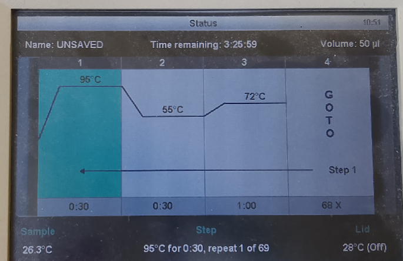
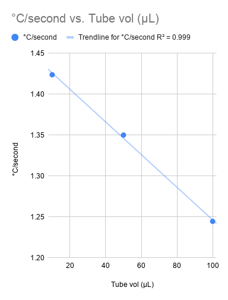

# This project aims at making a PCR thermal cycler program time estimator

A PCR program was defined like this: 

```
95 55 72 Temperatures
30 30 60 incubation times (seconds)
```

This program had no initial or final incubation for simplicity.  This program was entered in a Biorad T100. The number of cycles were set to 35, 52 or 69. The volume was set to 10, 20, 50 or 100 µL. The total estimated time for each setting was recorded. See an example below for 50 µL and 69 cycles: 



The program time for each combination was recorded in the table below:

| Vol | 35 cycles | 52 cycles | 69 cycles |
| --- | --------: | --------: | --------: |
| 10  |  01:42:47 |  02:32:39 |  03:22:32 |
| 20  |  01:42:48 |  02:32:40 |  03:22:33 |
| 50  |  01:44:34 |  02:35:17 |  03:25:59 |
| 100 |  01:47:30 |  02:39:38 |  03:31:46 |
 
The estimated time increases by the number of cycles, and by the volume of PCR mix in each tube.   

The proposed model sums all incubation times together and multiplies by the number of cycles.

`incubation_durations = (30 + 30 + 60) * number_of_cycles (seconds)`

Ramping temperature up and down is expected to take a certain time per degree. This time is assumed to be the same for all temperature ranges. Further, we assume that ramping up and down occurs at the same rate, which is probably a simplification.

`ramp_time = ( (95-55) + (72-55) + (95-72) ) * number_of_cycles / ramp_speed (seconds)`

Adding the two incubation times together yields the total estimated time.

`total_time = incubation_durations + ramp_time`

A Google [sheet](https://docs.google.com/spreadsheets/d/1bO1Fd2W0L2M1BvwtQbcqHzGbgaySR9RZVZRrdqqYRzQ/edit?gid=85526959#gid=85526959&range=A21) was used to collect the data and the `ramp_speed` was adjusted manually until it the calculated `total_time` calculated from the formula above  agreed closely with the result from the machine.

The `ramp_speed` was collected for three volumes in the table below:

| vol (µL) | ramp_speed °C/s |
| -------: | --------------: |
|       10 |          1.4237 |
|       50 |          1.3500 |
|      100 |          1.2445 |

It appears that the relationship between the `ramp_speed` and the PCR volume is practically linear. 
  

  
This should make it possible to create a function that accepts a PCR program, a PCR volume 
and a cycle count and return the estimated time required for the PCR program for this thermal cycler.


